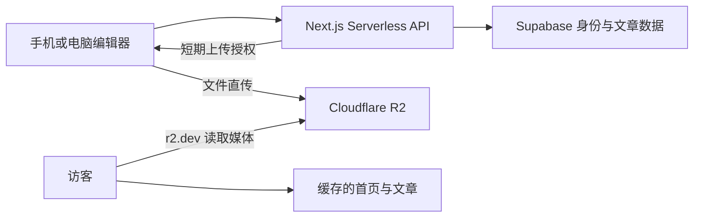

# 芝语：Serverless 架构建议

核对日期：2026-10-12。用户已认可按本方案准备，并报告创建了 GitHub 仓库与 R2 桶；尚未开始代码实现、接入或部署。平台操作见 platform-setup.md。

## 已确认的需求与边界

- 首页和文章均采用手帐风格，文章有独立网址。
- 使用网页编辑器；手机能够写文章、上传照片和视频。
- 主要读者在中国大陆，但用户明确接受先使用国外免费额度。
- 用户同意先用 Vercel 托管网站，Cloudflare R2 存媒体，以 `r2.dev` HTTPS 开发地址读取文件。
- 用户已认可 Next.js、Supabase 和 Tiptap 的架构方向，当前正在准备平台资源。
- 下述发布流程按“公开阅读、指定管理员编辑”设计；若以后需要家庭私密阅读，页面和媒体访问权限需另行设计。

## 推荐组成

| 层 | 推荐 | 职责 |
| --- | --- | --- |
| 阅读网站 | Next.js App Router，静态生成与 ISR | 手帐首页、独立文章、分类和归档；明确缓存公开文章 |
| 网页后台 | 同一项目 `/admin`，Tiptap 富文本编辑器 | 手机写稿、草稿保存、图注、照片与视频插入、预览、发布 |
| Serverless 接口 | Next.js Route Handlers / Vercel Functions，Node.js runtime | 管理员身份校验、草稿/发布逻辑、R2 上传授权、发布后刷新缓存 |
| 登录与文章数据 | Supabase Auth + PostgreSQL | 管理员登录、文章内容和发布版本、标签、媒体元数据 |
| 图片与视频 | Cloudflare R2 Standard | 原文件、展示图片、封面、短视频；测试用 `r2.dev` 公开读地址 |

维护一个 TypeScript 项目，服务端接口由 Vercel 托管运行；媒体传输直接走 R2。

## 内容与发布流程

1. 管理员在手机/电脑登录 `/admin`。
2. 文章以结构化富文本 JSON 保存，图片/视频节点引用媒体 ID 或 object key；文章内容与手帐排版分离。
3. 草稿自动保存；草稿和已发布快照分开。编辑已发布文章时，访客仍看到上一份发布版本。
4. 预览确认后发布，写入公开版本与发布时间。
5. 刷新对应文章、首页、分类和归档的缓存；后续请求按 Next.js 的缓存/再生成机制读取新版本。

当前 HTML 原型中的 query 示例路由以后替换为 `/posts/[slug]`，不会改变手帐阅读的设计方向。

## 媒体上传与读取

- 上传授权：接口校验管理员身份后，签发 R2 S3 API 的短期 PUT URL。R2 API 密钥留在服务端。
- 上传本体：浏览器直接向 `*.r2.cloudflarestorage.com` 的签名 URL 上传；大视频按需使用分片上传协议。
- 完成登记：上传完成后登记文件元数据，再插入正文，发布时引用已确认的文件。
- 展示读取：浏览器通过 `https://pub-….r2.dev/<object-key>` 读取图片/视频。这个公开读地址与上传接口是两个用途。
- R2 CORS 配置实际后台域名和本地开发 origin、必要方法/请求头；域名环境变化时同步调整。
- 数据库存 `object_key`、类型、尺寸、大小与图注，媒体基础 URL 集中配置。以后接自定义域名时更换基础 URL，不逐篇改正文。
- 图片生成适合手机阅读的展示尺寸；保留原比例。视频首版采用兼容的 MP4、封面和手动播放。自动转码/多清晰度属于后续媒体处理服务，不由 R2 存储功能承担。

## 免费额度与测试边界

- Vercel Hobby 面向个人、非商业项目；部署与 Functions 仍受使用额度限制。
- R2 Standard 当前每月包含 10 GB-month 存储、100 万 Class A 操作和 1000 万 Class B 操作，不收出网流量费；超额存储与请求仍计费。
- Supabase Free 当前包含 500 MB 数据库；一周无活动的免费项目会暂停。照片/视频放 R2，因此不占 Supabase 文件存储额度。
- `r2.dev` 是公开、有限流的开发访问地址，不提供自定义域名路径下的缓存等功能。当前测试可用，正式稳定使用时接 R2 自定义域名。
- Vercel Functions 请求/响应 payload 上限为 4.5 MB，因此媒体本体直接上传和读取 R2；Vercel 处理授权与元数据。
- 国内读者的实际访问体验仍需在普通手机网络实测，免费方案本身不保证国内连接质量。

## 第一版范围

优先完成：手帐阅读站、指定管理员登录、手机可用的富文本后台、草稿/预览/发布、R2 直传、发布缓存刷新。评论、复杂账号体系、自动视频转码可按后续真实需求再增加。

## 核对来源

- [Vercel Hobby](https://vercel.com/docs/plans/hobby)
- [Vercel Functions 限制](https://vercel.com/docs/functions/limitations)
- [Next.js revalidatePath](https://nextjs.org/docs/app/api-reference/functions/revalidatePath)
- [Supabase Free 定价与暂停规则](https://supabase.com/pricing)
- [Supabase Auth](https://supabase.com/docs/guides/auth)
- [R2 定价](https://developers.cloudflare.com/r2/pricing/)
- [R2 公共开发 URL 与自定义域名](https://developers.cloudflare.com/r2/buckets/public-buckets/)
- [R2 签名上传 URL](https://developers.cloudflare.com/r2/api/s3/presigned-urls/)
- [R2 CORS](https://developers.cloudflare.com/r2/buckets/cors/)
- [Tiptap Image 扩展](https://tiptap.dev/docs/editor/extensions/nodes/image)
